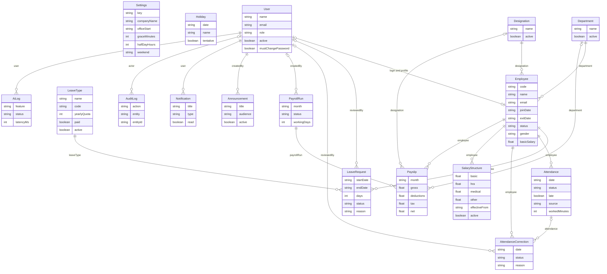

# Data model

Seventeen Mongoose models. Business dates are `YYYY-MM-DD` strings in Asia/Karachi. Check-in times, review times, and `createdAt` are real timestamps. The picture below is also saved as [schema.png](schema.png).

`Settings` and `Holiday` have no foreign keys. They are company-wide rules. `User.employee` and `Employee.user` point at each other when a person can sign in. Admin often has no employee row. An employee id is not the login id.

## settings

One row. `key` is always `company`.

| Field | Notes |
| --- | --- |
| `companyName` | From setup |
| `officeStart` | `HH:mm`, default `09:00` |
| `graceMinutes` | Default 15. Late is strictly after start plus grace |
| `halfDayHours` | Default 5 |
| `weekend` | Weekday names, default Sat and Sun |
| `officeLat`, `officeLng`, `radiusMeters` | Used only if a camera payload is sent. Default radius 150 |
| `latePenalty.enabled` | Default false |
| `latePenalty.latesPerHalfDay` | Default 3 |

## holidays

| Field | Notes |
| --- | --- |
| `date` | `YYYY-MM-DD`, unique lookup by date |
| `name` | Shown on the calendar |
| `tentative` | Still a day off until someone edits it |

## departments

| Field | Notes |
| --- | --- |
| `name` | Unique |
| `active` | Soft switch. Delete is refused while employees point here |

## designations

| Field | Notes |
| --- | --- |
| `name` | Unique across the company |
| `active` | Same delete rule as departments |

## users

Collection `users`. `passwordHash` is `select: false`.

| Field | Notes |
| --- | --- |
| `email` | Unique, stored lowercase |
| `role` | `admin`, `hr`, or `employee` |
| `active` | False blocks login |
| `mustChangePassword` | True for a temporary password |
| `employee` | Employee id, or null for a login with no profile |

## employees

| Field | Notes |
| --- | --- |
| `code` | Unique, stored uppercase |
| `email` | Unique |
| `department`, `designation` | Required ids |
| `joinDate`, `exitDate` | `YYYY-MM-DD`. `exitDate` may be null |
| `status` | `active`, `probation`, or `exited` |
| `gender` | `male`, `female`, `other`, or `undisclosed` |
| `salary.basic` | Greater than zero. Payroll uses the salary-structure history, not only this field |
| `user` | Login id, or null |
| `faceDescriptor` | Array of numbers from the browser face model. `select: false`. Never a photo. Omitted from API responses |
| `faceModel` | Model name sent at enrollment, for example `human-faceres`. Null when not enrolled |
| `faceEnrolledAt` | Timestamp of enrollment. Null when not enrolled. API responses expose this as `faceEnrolled: true/false` |

## leaveTypes

Setup inserts Annual, Sick, Casual, and Unpaid.

| Field | Notes |
| --- | --- |
| `code` | Unique, uppercase. `ANNUAL`, `SICK`, `CASUAL`, `UNPAID` |
| `yearlyQuota` | Null means unlimited |
| `paid` | Unpaid is false |
| `active` | Inactive types cannot be requested |

## leaveRequests

| Field | Notes |
| --- | --- |
| `employee`, `leaveType` | Required |
| `startDate`, `endDate` | Calendar days |
| `days` | Working days, counted on the server |
| `status` | `pending`, `approved`, `rejected`, `cancelled` |
| `reviewedBy`, `reviewedAt`, `reviewComment` | Set when HR reviews |
| `smartLeaveText` | The sentence from smart leave, if the client sent it. The request is still saved only by the leave route |

## attendance

One row per employee per `date` (unique index).

| Field | Notes |
| --- | --- |
| `checkIn`, `checkOut` | Timestamps. The server sets them |
| `status` | `present`, `late`, `half_day`, `absent`, `missing_checkout`, or `on_leave` |
| `late` | Separate from status, so a half day can still be a late arrival |
| `source` | `web`, `camera`, or `correction` |
| `location`, `faceCount` | Filled for a camera payload |
| `faceMatchScore` | Camera only. Similarity from 0 to 1, rounded to 2 decimal places. The descriptor is not stored |
| `liveness` | `true` when a camera punch passed the blink check. Otherwise null |
| `workedMinutes` | Set on check-out |

`absent` and `on_leave` are usually calculated when a board is read, not stored.

## attendanceCorrections

| Field | Notes |
| --- | --- |
| `employee`, `date` | Who and which Karachi day |
| `attendance` | Existing row, or null |
| `requestedCheckIn`, `requestedCheckOut` | At least one is required by the service |
| `status` | `pending`, `approved`, `rejected` |
| `reviewedBy` | HR user |

## salaryStructures

History of pay. A partial unique index allows only one `active: true` row per employee.

| Field | Notes |
| --- | --- |
| `basic` | Greater than zero |
| `allowances.hra`, `medical`, `other` | Stored amounts. Defaults are 40%, 10%, and 0 when HR omits them |
| `effectiveFrom`, `effectiveTo` | `YYYY-MM-DD`. `effectiveTo` null means open |
| `active` | The current row |

## payrollRuns

One run per `month` (`YYYY-MM`).

| Field | Notes |
| --- | --- |
| `status` | `draft` or `finalized` |
| `workingDays` | Working days in that month |
| `totals` | `employees`, `gross`, `deductions`, `tax`, `net` |
| `createdBy`, `finalizedBy`, `finalizedAt` | User ids |

## payslips

Unique on `payrollRun` plus `employee`.

| Field | Notes |
| --- | --- |
| `month` | `YYYY-MM` |
| `department`, `designation` | Copies at the time of the run |
| `gross`, `deductions`, `tax`, `net` | Totals the dashboards sum |
| `breakdown` | Must include `inputs`, `earnings`, `deductions`, `tax`, `net`, and `proration` |

## announcements

| Field | Notes |
| --- | --- |
| `title`, `body` | Required |
| `audience` | `all`, `admin`, `hr`, or `employee` |
| `createdBy` | User id |
| `active` | Inactive rows are hidden from employees |

## notifications

`user` is the login id, not the employee id.

| Field | Notes |
| --- | --- |
| `type` | `leave`, `payslip`, `announcement`, `attendance`, or `system` |
| `read` | Default false |
| `entity`, `entityId` | Optional link back to the source row |

## auditLogs

Append-only. The schema throws if something tries to update or delete.

| Field | Notes |
| --- | --- |
| `actor` | User id, or null |
| `action` | For example `leave.review` or `payroll.finalize` |
| `entity`, `entityId` | What changed |
| `before`, `after` | Plain JSON. Password hashes are not stored |
| `timestamp` | When the service wrote the row |

## aiLogs

One row per assistant call.

| Field | Notes |
| --- | --- |
| `user`, `role` | Who asked |
| `feature` | `chat`, `summary`, `smart_leave`, `explain_payslip`, or `policy` |
| `message` | The user text, trimmed |
| `tools` | Tool names that ran |
| `response` | The answer text, trimmed |
| `latencyMs` | How long the call took |
| `status` | `ok`, `error`, `timeout`, or `refused` |
| `error` | Short failure text |
